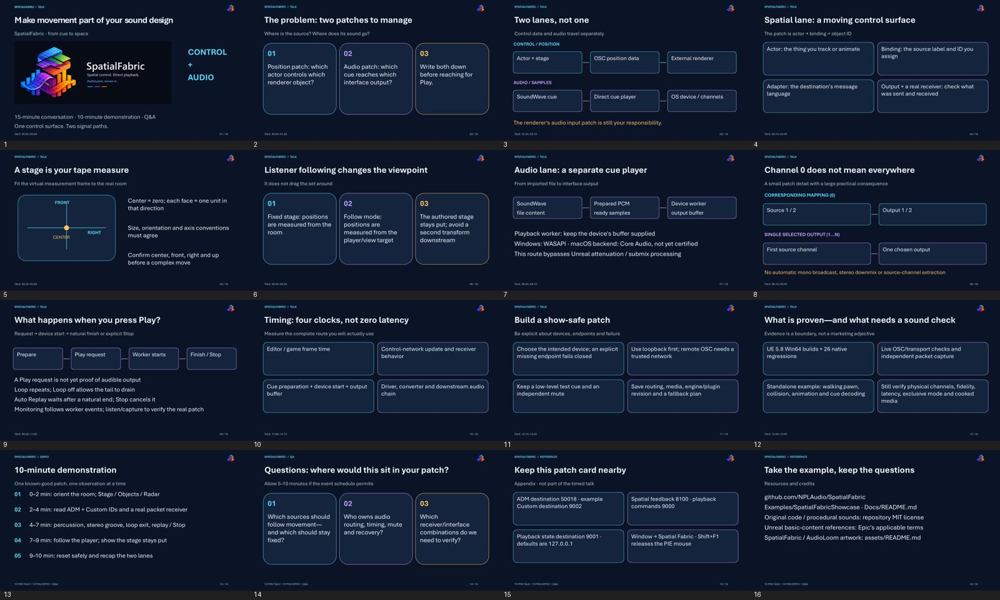

# SpatialFabric — From Cue to Space

**Audience:** sound designers, operators and system designers, not programmers.

- [Editable PowerPoint](SpatialFabric_From_Cue_to_Space.pptx)
- [PDF handout](SpatialFabric_From_Cue_to_Space.pdf)
- [Timed presenter notes](PRESENTER_GUIDE.md) — also embedded in each slide's Notes pane
- [10-minute demo run sheet](DEMO_RUNSHEET.md)
- [Slide content source](slides.json)



The generated deck was opened and rendered as 16 slides in Microsoft PowerPoint;
PDF and this contact sheet come from that rendering. Still rehearse on the actual
presentation machine/projector, especially if another application substitutes fonts.

## Timing

| Segment | Planned time | Slides |
|---|---|---|
| Backend discussion in sound-design language | **15 minutes** | 1–12; individual durations total 900 seconds |
| Live demonstration | **10 minutes** | 13 plus the separate run sheet |
| Q&A | **Open**; allow 5–10 minutes in the event agenda | 14 |
| Patch card / resources | Reference only | 15–16 |

The talk is 15 minutes **before** the 10-minute demo, not a 15-minute total session.
Slides advance manually; the timings are rehearsal guidance, not forced transitions.
The deck is 16:9. Text, diagrams, patch arrows and notes are editable PowerPoint
objects; artwork is a raster brand asset. Aptos is requested; another application
may substitute fonts, so inspect layout on the presentation computer.

## What the backend discussion covers

The narrative follows a familiar patch: control data versus samples, stage as a
measurement frame, bindings as object patching, a separate cue player, direct
channels, preloading, buffering, timing/failure and show safety. It explains WASAPI/
Core Audio only where useful to a designer. No source code or programming exercise
is required. Speaker notes flag claims to avoid, especially automatic spatialization,
zero latency, head tracking and untested manufacturer/hardware certification.

## Rehearse with the actual system

Prepare/build the [example project](../Examples/SpatialFabricShowcase/README.md).
Choose a safe interface/channel/level, check the physical patch, close competing
OSC listeners and stop autoplay/replay before the audience arrives. Open the panel
at a readable size and arrange your receiver monitor before beginning the timer.
If the venue has no external renderer/audio patch, say explicitly that you are
showing control data and separate cue playback, not end-to-end spatial rendering.

Do not run the automated transport validator during the presentation: it deliberately
tries a nonexistent device and emits an expected error. Use the planned manual demo.
Have the fallback sequence in the run sheet ready if media, network or display fails.

## Rebuild / edit

```sh
python -m pip install -r Presentations/requirements.txt
python Tools/build_presentation.py
```

Edit `slides.json` for wording, timing and notes, then regenerate the deck and
presenter Markdown. Direct PowerPoint edits are fine for a one-off event, but are
not automatically written back to JSON. Keep a backup before regenerating.
The builder asserts the 900-second talk and 600-second demo totals. It regenerates
the PPTX and Markdown, not the PDF/contact sheet. On Windows with PowerPoint installed,
`powershell -File Tools/export_presentation.ps1` exports a refreshed PDF and temporary
PNG frames for visual inspection. Export manually in another application if needed;
font/layout substitutions must be checked again.

## Credits and limits

Code, original procedural sound designs and presentation text/diagrams are provided
under the repository MIT license. Artwork source/attribution is documented in
[assets/README.md](../assets/README.md). Referenced Unreal content remains under
Epic's applicable terms. No venue, processor, interface or manufacturer endorsement
is implied. Validation claims are scoped in [VALIDATION.md](../VALIDATION.md).
