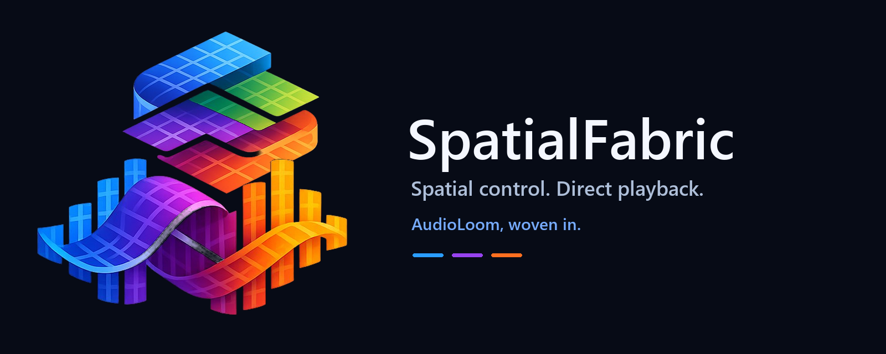

<div align="center">

</div>

# SpatialFabric

**Unreal actors as a spatial control surface. SoundWaves as direct-output cues.**

SpatialFabric combines ADM-OSC/Custom OSC spatial positioning with AudioLoom
OS-device/channel playback in one plugin. Open **Window → Spatial Fabric** for
Audio Routing (default), Stage, Objects, Radar, Output, Scene Objects and Playback.

> **Two independent signal paths:** spatial output sends control data, not audio.
> Direct playback sends PCM to an OS output device, not automatically to an ADM
> renderer. Connecting those paths is part of your show-system patch.

[MIT license](LICENSE) · [Documentation](Docs/README.md) ·
[Playable example](Examples/SpatialFabricShowcase/README.md) ·
[Validation and limits](VALIDATION.md)

## SpatialFabric repositories

| Repository | Purpose |
|---|---|
| [SpatialFabric](https://github.com/NPLAudio/SpatialFabric) | Shared hub: OSC contracts, JSON schemas, golden wire fixtures and OSC Controller source/releases |
| [SpatialFabric-Unreal](https://github.com/NPLAudio/SpatialFabric-Unreal) | This Unreal plugin and four-room example |
| [SpatialFabric-Unity](https://github.com/NPLAudio/SpatialFabric-Unity) | Unity UPM port, native audio backend and four-room walking showcase |
| [SpatialFabric-Godot](https://github.com/NPLAudio/SpatialFabric-Godot) | Godot integration |
| [AudioLoom](https://github.com/NPLAudio/AudioLoom) | Legacy standalone Unreal playback repository; access-controlled/private, now integrated here |

The former Unreal `SpatialFabric` repository is now `SpatialFabric-Unreal`;
the former `SpatialFabric-Interop` is now the shared `SpatialFabric` hub.
Controller source lives in the hub's [`Apps/OSCController`](https://github.com/NPLAudio/SpatialFabric/tree/main/Apps/OSCController).
Download **OSC Controller 1.4.0** from the [hub 1.0.0 release](https://github.com/NPLAudio/SpatialFabric/releases/tag/v1.0.0).

Unity and Godot validation and platform/hardware limits are documented in their own
repositories; Unreal build results do not certify those integrations or vice versa.

## Choose your starting point

| You want to… | Start here |
|---|---|
| Try a ready-made level | [Example setup](Examples/SpatialFabricShowcase/README.md) |
| Add the plugin to a show/project | [Getting started](Docs/GettingStarted.md) |
| Send positions to an external renderer | [Spatial routing](Docs/SpatialRouting.md) |
| Configure cue output crosspoints/offline interfaces | [Audio Routing grid](Docs/AudioRoutingMatrix.md) |
| Manage all placed objects' SpatialFabric properties | [Scene Objects manager](Docs/SceneObjectManager.md) |
| Play cues to a device/channel | [Audio playback and CSV](Docs/AudioPlayback.md) |
| Query scene configuration as JSON/OSC | [Scene query command and examples](Docs/SceneQuery.md) |
| Use a standalone OSC desktop controller | [Shared OSC Controller app](https://github.com/NPLAudio/SpatialFabric/tree/main/Apps/OSCController) |
| Connect a controller or inspect packets | [OSC reference](Docs/OSCReference.md) |
| Find out why something is silent/invisible | [Troubleshooting](Docs/Troubleshooting.md) |
| Build, test or extend the code | [Development](Docs/Development.md) and [codebase guide](Docs/CODEBASE_GUIDE.md) |
| Download/install a release | [Release artifacts and notes](RELEASE_NOTES.md) |

## Requirements and honest support status

- **Automated build/test evidence: UE 5.8 on Win64.** Build against your installed engine.
- **macOS Apple Silicon: user-tested and reported working.** Exact Unreal/macOS
  versions and audio-interface/test coverage were not recorded. This report does not
  cover Intel Macs; see [validation details](VALIDATION.md#macos-apple-silicon-user-reported-validation).
- Windows native builds require Visual Studio 2022 C++ tools, a compatible Windows
  SDK and .NET Framework SDK; see [build instructions](Docs/Development.md).
- Runtime dependency: Unreal's built-in **OSC** plugin. This repository contains
  one `SpatialFabric.uplugin` and four retained runtime/editor modules.
- The example is a small **C++ project** with its own walking character. It does not
  require Epic's FirstPerson character/animation content or any sample download.
- Optional editor regeneration tools require Python Editor Script Plugin,
  Editor Scripting Utilities and Sequencer Scripting; the example enables them.
- **Live input (microphone / line in to a chosen output)** is implemented for Windows (WASAPI) and macOS
  (Core Audio source). Windows is built and silently tested; **macOS live input is uncompiled and untested**.
  See [Audio playback](Docs/AudioPlayback.md#live-input-microphone--line-in).
- WASAPI is implemented for Windows; Core Audio is implemented for macOS.
  The Apple Silicon user report is separate from Windows automated results and
  does not certify every Core Audio device, format or lifecycle scenario.
  No Linux direct-device playback certification is claimed.

Native Editor/Development/Shipping compilation does **not** certify physical audio
channels, exclusive mode, latency, all interfaces, or cooked codec playback.
See [remaining release gates](VALIDATION.md).

The plugin-only release ZIP intentionally omits the example and standalone apps.
Unreal releases also provide a standalone source-example ZIP and an Unreal-specific
complete-source ZIP, with a commit manifest and SHA-256 checksums. Controller source
and the portable Windows download are released separately in the shared hub.
The retired presentation is available in the historical
[2.0.3 release](https://github.com/NPLAudio/SpatialFabric-Unreal/releases/tag/v2.0.3), not this release.
A push to main alone does not create a release or version tag.

## Install into your project

1. Back up the project and close Unreal. If upgrading AudioLoom, remove its
   standalone plugin and `.uproject` entry; do not load duplicate module names.
2. Place this repository at `YourProject/Plugins/SpatialFabric`.
3. Enable **SpatialFabric** and **OSC**, then regenerate/build your project's
   Editor target with the supported toolchain. Source releases do not include
   engine-independent ready-to-use DLLs.
4. Open the project and **Window → Spatial Fabric**.

The legacy `/Script/AudioLoom` module/class identities remain for existing
Blueprints, assets and C++ callers. Read the [migration checklist](Docs/AudioPlayback.md#migration-from-standalone-audioloom--spatialfabric-1x)
for intentional OSC-address, listener and cooked-loading changes.

## Run the published example

The actual `.umap`, `.uasset` files, original WAV sources, configuration and small
walking-character source are checked in under **`Examples/SpatialFabricShowcase`**.
The showcase now has four separate demo rooms along a hallway: spatial motion,
mono percussion, stereo groove and replay. It removes dummy speaker models and
billboards while keeping real playback/OSC controls and a walkable collision floor.
No symlink, local sandbox folder, MCP server, or external sample library is needed.

From this repository root:

```powershell
python Tools/prepare_example.py --destination C:/dev/SpatialFabricShowcase
```

This creates a standalone source project with a project-local plugin. It refuses
nonempty destinations. Build/open `C:/dev/SpatialFabricShowcase/SpatialFabricShowcase.uproject`,
then press Play: **WASD + mouse**, **Space** to jump, **Shift+F1** for editor controls.
The level includes a surrounding collision floor and perimeter barriers.
**Audio is manual-start and quiet**; choose a safe output before pressing Play.

Follow the [10-minute tour](Docs/SpatialSandboxDemo.md). The repository project can
also reference the plugin through `AdditionalPluginDirectories`; preparing a
standalone copy is recommended when moving or distributing the example.

## First spatial patch

1. In the Stage tab, explicitly spawn a Manager if none is present; assign/spawn
   a Stage Volume. Merely opening the plugin must not add actors to your map.
2. Match the stage box to the area and set its physical dimensions in meters.
3. Select an actor, then **Objects → + Add Selected Actors**. Give it a positive
   object ID and the intended adapter target.
4. Set the destination IP/port. Newly constructed managers enable ADM-OSC on
   loopback `50018`; Custom is initially disabled. Review defaults before a show.
5. Read **Output**, then verify actual incoming UDP in your receiver. A preview
   or successful UDP send is not an acknowledgement from an audio processor.

The spatial-control workflow, coordinate conventions, per-target IDs, metadata, listener
following and Custom templates are covered in [Spatial routing](Docs/SpatialRouting.md).

## First direct-audio patch

For silent central configuration, open **Audio Routing**, explicitly **Refresh
Interfaces**, then use cue-row × interface/channel crosspoints or the selectors.
Cached unplugged interfaces remain available; checks mean configured, not live.
No manager is required. See [routing/Undo safety](Docs/AudioRoutingMatrix.md).
Use **Scene Objects** to explicitly attach playback to ordinary placed actors.

1. Add an **Audio Loom** actor/component and assign a supported SoundWave.
2. Choose the intended OS output device. Empty device ID means default output;
   a missing explicitly selected endpoint fails rather than playing elsewhere.
3. Channel **0** maps source channels to corresponding device channels. Channel
   **1..N** sends the **first source channel** to just that physical output.
4. Press Play/Stop. Prepare Audio can predecode before timing-critical cues.

There is no automatic downmix, multichannel duplication, spatial panning,
Unreal submix processing or renderer patch created by these steps.
See [playback policy](Docs/AudioPlayback.md) before using show media.

## Ports, permissions and safety

| Purpose | Default |
|---|---|
| ADM position/metadata destination | `127.0.0.1:50018` |
| Spatial numeric feedback listener | `127.0.0.1:8100` |
| Playback command listener, started on request | `127.0.0.1:9000` |
| Playback worker-state monitoring destination | `127.0.0.1:9001` |
| Extra Custom destination in the example only | `127.0.0.1:9002` |

Spatial settings live in **`Config/DefaultSpatialFabric.ini`**; playback OSC
settings live in **`Config/DefaultEngine.ini`**. These are separate permission
switches. Packaged networking is opt-in for each. Loopback binds remain loopback;
IPv4 unicast receivers verify real socket binding and reject malformed input.
OSC is unauthenticated. Remote control requires an explicit trusted-network and
firewall decision. The shipped example does **not** enable editor MCP.

## Backend, in sound-design terms

Think of the spatial path as a moving control surface: actors are tracked sources,
the stage is the measurement frame, bindings are the object patch, and the renderer
receives position/width/gain/mute messages. Think of direct playback as a separate
cue player patched straight to an interface. A buffering worker keeps audio moving
while the editor draws the next frame; that separation does not make the entire
system sample-accurate or remove driver, converter and network delays.

The operator guides explain both paths; the room example and scene-query tools
provide a practical walkthrough. Older presentation materials remain in the
[2.0.3 release archive](https://github.com/NPLAudio/SpatialFabric-Unreal/releases/tag/v2.0.3).

## Validation

```sh
python -m unittest discover -s Tools -p "test_*.py"
python Tools/validate_unreal.py --engine "C:/Program Files/Epic Games/UE_5.8"
```

The native runner builds disposable copies and judges Unreal's JSON report, not
exit code alone. Current evidence includes **29 native regressions**, Win64
Editor/Development/Shipping builds, live editor/PIE checks and real UDP capture.
The published example has separate compilation and silent PIE smoke coverage.
Exact commands, evidence and exclusions are in [VALIDATION.md](VALIDATION.md).

## Repository map

- `Source/SpatialFabric`, `SpatialFabricEditor`: spatial pipeline and editor UI.
- `Source/AudioLoom`, `AudioLoomEditor`: direct playback and retained legacy identity.
- `Source/Shared`: exact-bind, bounded OSC input shared without a module cycle.
- `Examples/SpatialFabricShowcase`: runnable example assets/project/source audio.
- `Tools`: validation, preparation, branding and editor automation.
- `Docs`: current operator/developer guides; `AUDIT.md` is a **historical pre-fix** report.
- `RELEASE_NOTES.md`: artifact selection, installation and current release limits.

## License and support

Plugin/example/tool source is MIT; see [LICENSE](LICENSE). Original AudioLoom
notices remain in [ThirdParty/AudioLoom/LICENSE](ThirdParty/AudioLoom/LICENSE).
Original artwork provenance is in [assets/README.md](assets/README.md).
The example references Unreal Engine basic content; that content remains governed
by Epic's applicable terms, not this repository's MIT license.

External manufacturers' trademarks belong to their owners. No manufacturer
endorsement, processor compatibility certification or hardware approval is implied.
For processor deployment, confirm the exact firmware, address set, coordinate and
object-numbering requirements with its documentation and a real receiver test.

If this project helps your work, consider [buying me a coffee](https://buymeacoffee.com/notpunny).
